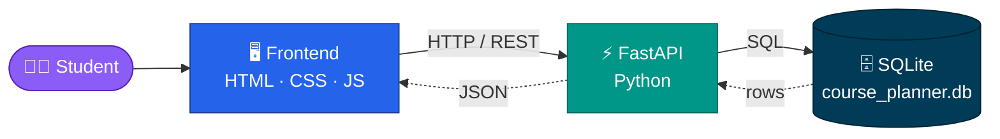

# UIU CSE Course Planner

<!-- markdownlint-disable MD033 -->

<div align="center">


[](https://github.com/heyaftab/uiu-course-planner)

**A web-based academic planner built for the CSE students of United International University.**

<p align="center">
  
  
  
  
  
  
</p>

<p align="center">
  
  
  
  
  
  
</p>

<p align="center">
  <a href="#-features"><kbd> ✨ Features </kbd></a>
  <a href="#-quick-start"><kbd> ⚡ Quick Start </kbd></a>
  <a href="#-architecture"><kbd> 🏗️ Architecture </kbd></a>
  <a href="#-roadmap"><kbd> 🔮 Roadmap </kbd></a>
  <a href="#-faq"><kbd> ❓ FAQ </kbd></a>
  <a href="#-contributing"><kbd> 🤝 Contribute </kbd></a>
</p>

</div>

<!--
  📸 Add a screenshot or GIF at docs/preview.png, then uncomment:

<div align="center">
  
</div>
-->


## 💡 Why this exists

> *"Which courses did I finish? What's left? What can I take next trimester?"*

Every UIU CSE student asks these questions every single trimester, and the answers usually live across spreadsheets, PDFs, and memory. **This planner puts everything in one place.**

<div align="center">

| 📊 | 🗓️ | 🎓 |
| :---: | :---: | :---: |
| **Track** every credit | **Plan** every trimester | **Reach** graduation with a clear roadmap |

</div>


## ✨ Features

<table align="center">
  <tr align="center">
    <td width="25%" valign="top">
      <h1 align="center">📚</h1>
      <b align="center">Course Management</b><br/><br/>
      Browse and manage every available CSE course.
    </td>
    <td width="25%" valign="top">
      <h1 align="center">🗓️</h1>
      <b align="center">Trimester Planning</b><br/><br/>
      Lay out courses to match your academic progress.
    </td>
    <td width="25%" valign="top">
      <h1 align="center">🎯</h1>
      <b align="center">Academic Planning</b><br/><br/>
      Separate completed, ongoing and planned courses.
    </td>
    <td width="25%" valign="top">
      <h1 align="center">🔍</h1>
      <b align="center">Instant Search</b><br/><br/>
      Find any course by code or name in seconds.
    </td>
  </tr>
  <tr align="center">
    <td valign="top">
      <h1 align="center">📊</h1>
      <b align="center">Credit Tracking</b><br/><br/>
      Live count of completed and planned credits.
    </td>
    <td valign="top">
      <h1 align="center">💾</h1>
      <b align="center">Persistence</b><br/><br/>
      Course and planning data stored with SQLite.
    </td>
    <td valign="top">
      <h1 align="center">⚡</h1>
      <b align="center">Fast Backend</b><br/><br/>
      Lightweight, high-performance FastAPI.
    </td>
    <td valign="top">
      <h1 align="center">📱</h1>
      <b align="center">Responsive UI</b><br/><br/>
      Smooth on desktop and mobile screens.
    </td>
  </tr>
</table>


## 🛠️ Tech Stack

<div align="center">


</div>

<br/>

| Layer | Technologies |
| :--- | :--- |
| 🎨 **Frontend** | HTML5 · CSS3 · Vanilla JavaScript |
| ⚙️ **Backend** | Python · FastAPI |
| 🗄️ **Database** | SQLite |
| 🧰 **Tooling** | Git · GitHub · REST API · VS Code |


## 🏗️ Architecture



<details>
<summary><b>📂 Project Structure</b> (click to expand)</summary>

<br/>

```text
uiu-course-planner/
├── 🎨 frontend/
│   ├── index.html
│   ├── style.css
│   └── script.js
├── ⚙️ backend/
│   ├── main.py
│   ├── database.py
│   └── ...
├── 🗄️ database/
│   └── course_planner.db
├── 📄 requirements.txt
├── 📘 README.md
└── 🚫 .gitignore
```

> 💡 The exact structure may vary depending on the current implementation.

</details>


## ⚡ Quick Start

> **Requirements:** 🐍 Python 3.9+ and 🔧 Git

```bash
# 1️⃣ Clone
git clone https://github.com/heyaftab/uiu-course-planner.git
cd uiu-course-planner

# 2️⃣ Create a virtual environment
python3 -m venv venv

# 3️⃣ Install dependencies (after activating, see below)
pip install -r requirements.txt

# 4️⃣ Launch 🚀
uvicorn backend.main:app --reload
```

<table align="center">
  <tr align="center">
    <td><b>🍎 macOS / 🐧 Linux</b></td>
    <td><b>🪟 Windows</b></td>
  </tr>
  <tr>
    <td>

```bash
source venv/bin/activate
```

</td>
    <td>

```bash
venv\Scripts\activate
```

</td>
  </tr>
</table>

Run the activation command **between steps 2 and 3**.

| 🌐 Service | 🔗 URL |
| :--- | :--- |
| 🔌 API | <http://127.0.0.1:8000> |
| 📖 Swagger docs | <http://127.0.0.1:8000/docs> |

## ☁️ Free static hosting with GitHub Pages

The included GitHub Actions workflow publishes the frontend from `Course Planner/backend/frontend` to GitHub Pages. In the repository, open **Settings → Pages**, set the build and deployment source to **GitHub Actions**, then push to `main` or run **Deploy static content to Pages** from the **Actions** tab. GitHub will show the published site URL in the workflow deployment.

This static deployment does not need Railway or a database. Signups and planner data are stored in the current browser only; they do not sync across devices and may be lost if browser storage is cleared. Use a unique password, not one used for other accounts. For shared accounts or cross-device storage, deploy a backend with a persistent database.

## 🚂 Deploy to Railway

Set the Railway service **Root Directory** to `Course Planner/backend`. This folder contains both the Node server and its `frontend` files, so Railway can package and serve the page and its assets together. Railway uses the `start` script in `package.json` and provides the listening port through `PORT`.


## 🖥️ How to Use


## 🎯 What It Keeps Track Of

<div align="center">

| ✅ Completed courses | 📋 Remaining courses | 🔗 Prerequisites |
| :---: | :---: | :---: |
| **🎓 Credit requirements** | **🗓️ Upcoming trimesters** | **📝 Planned courses** |

</div>


## 🔮 Roadmap

| 🧠 Smart Planning | 📈 Progress & Insights | 👥 Community & Data | ☁️ Platform |
| :--- | :--- | :--- | :--- |
| ⬜ Prerequisite validation | ⬜ Degree progress visualization | ⬜ Faculty & section info | ⬜ Student authentication |
| ⬜ Trimester recommendations | ⬜ CGPA calculation | ⬜ Course ratings & reviews | ⬜ Cloud database |
| ⬜ Course conflict detection | | | ⬜ Mobile-friendly polish |
| ⬜ Class schedule generation | | | ⬜ Production deployment |


## ❓ FAQ

<details>
<summary><b>Who is this for?</b></summary>
<br/>
Computer Science & Engineering students at United International University (UIU) who want a simple way to plan their degree.
</details>

<details>
<summary><b>Where is my data stored?</b></summary>
<br/>
Locally in a SQLite database file (<code>database/course_planner.db</code>). Nothing leaves your machine unless you deploy the app yourself.
</details>

<details>
<summary><b>The API won't start. What now?</b></summary>
<br/>
Make sure your virtual environment is activated, dependencies are installed, and you run <code>uvicorn backend.main:app --reload</code> from the project root.
</details>

<details>
<summary><b>Can I reuse this for another department?</b></summary>
<br/>
Yes, for educational purposes. Swap in a different course list and you're set.
</details>


## 🔐 Security

> ⚠️ Never commit credentials or sensitive configuration files.

```text
.env
venv/
__pycache__/
*.pyc
*.db
```

## 🤝 Contributing

Contributions, ideas and bug reports are always welcome. 💙

```bash
git checkout -b feature/your-feature     # 🌿 branch
git commit -m "Add your feature"         # 💾 commit
git push origin feature/your-feature     # 🚀 push
```

Then open a **Pull Request**.

<div align="center">

<a href="https://github.com/heyaftab/uiu-course-planner/graphs/contributors">
  
</a>

</div>

## 📄 License

Currently intended for **educational and academic purposes**. To allow public reuse, consider adding an open-source license such as [MIT](https://choosealicense.com/licenses/mit/).


<div align="center">

## 👨‍💻 Author

**Aftab Uddin Ahmad**<br/>
Computer Science & Engineering · United International University

<a href="https://github.com/heyaftab"></a>
<a href="https://hey-aftab.lovable.app"></a>

<br/><br/>

### ⭐ Star History

<a href="https://star-history.com/#heyaftab/uiu-course-planner&Date">
  
</a>

<br/>

**If this project helped you, drop a star. It means a lot!** ⭐


</div>
